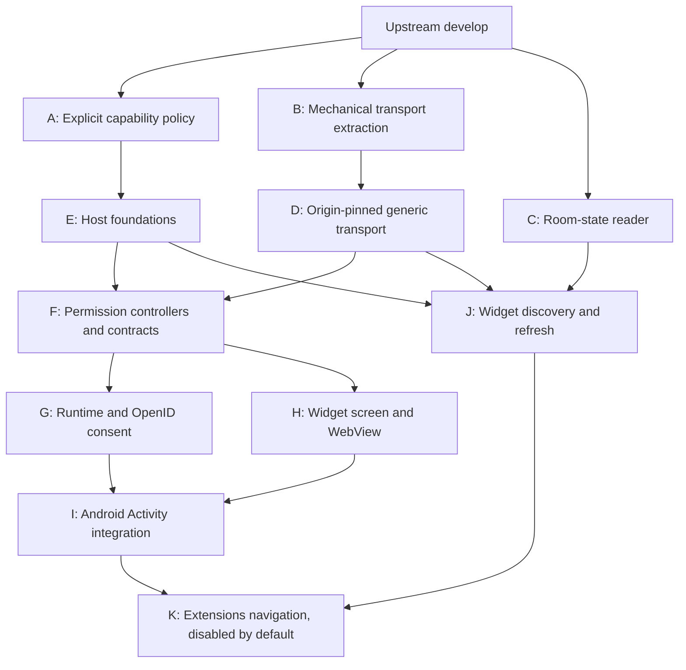

# Widget upstream submission review — 29 October 2026

This guide supersedes the old preparation guide's revision table, not its design history. The eight historical fork PRs are not the upstream submission set. The replacement consists of eleven scoped review units.

## What is verified

The clean candidates were refreshed onto upstream `078b6176efcb55c44a60919543104a75a145db93`, 95 commits beyond the former preparation baseline. The export resolved the inspected Matrix implementation Gradle overlap by preserving upstream's JSON/native-call changes and adding only the room-state reader's networking dependencies.

[Export and exact-candidate validation](https://github.com/0cwa/element-x-android/actions/runs/40963545887) verified upstream ancestry, whitespace, incremental scope and full-tree parity against an independent merge of upstream into the prior final candidate. Each incremental unit has fewer than 500 added production lines. Fork CI/Maestro repairs are absent from the submission diffs. Historical branch history and original feature authorship were preserved.

At the last check during this audit, candidate A, B, C, D and F compilation, focused tests, Konsist and formatting jobs had passed. The other candidate jobs and full integration unit/screenshot/coverage checks were still running or queued. Do not infer a pass for those jobs.

The parity result applies to the exported integration `8e01cf8a90bd881ca4d2598342915ed5199fd4a6`. K subsequently gained a deliberate two-line preview-only follow-up at `bec087b83f0a0f2d403130b201f67ed2a40348c4`: loading and error states in the Extensions preview provider. [Separate preview validation](https://github.com/0cwa/element-x-android/actions/runs/40965356264) records and verifies the four additional baselines on CI, publishing only those files after success. That result was not yet complete. Its successful publication will advance K again; inspect the current ref and job evidence before submission.

## Candidate branches

All branches below have the prefix `submit/widget-40963545887/`. The complete original SHA/base/task manifest is the `widget-submission-manifest` artifact on the export run.

| Part | Branch suffix | Head at this audit | Prerequisites | Added production lines |
|---|---|---|---|---:|
| A | a-capability-policy | `73df658f` | None | 161 |
| B | b-transport-extraction | `1ea870dd` | None | 44 |
| C | c-room-state | `906ab92e` | None | 143 |
| D | d-secure-transport | `2e11fa0c` | B | 258 |
| E | e-host-foundations | `6ecde306` | A | 335 |
| F | f-host-permissions | `7c211c95` | E, D | 359 |
| G | g-host-runtime | `f0b3d08e` | F | 480 |
| H | h-host-screen | `70a0eaf5` | F | 439 |
| I | i-host-activity | `069f8da4` | G, H | 233 |
| J | j-discovery | `de7c14ae` | C, E, D | 251 |
| K | k-extensions-navigation | `bec087b8` | I, J | 386 |

GitHub renders this Mermaid directly in PR Markdown. Embed it in each body rather than uploading a generated picture.

Open independent roots first. For dependent units, wait for prerequisites to land in upstream `develop`, or agree an upstream-owned stacking base. The fork's `base-*` refs are exact-diff aids, not upstream PR targets. Opening every dependent fork head against upstream `develop` immediately would expose cumulative prerequisites instead of the intended individual changes. The omnibus integration PR is not a twelfth submission.

## Remaining readiness limits

The full series is not yet certified ready for review. Exact-revision jobs, the preview follow-up and real widget/API-24 acceptance remain outstanding. The historical Maestro suite covers ordinary messaging navigation, not the new widget/OpenID/security path. Check both startup modes, consent grant/denial, stale callbacks after teardown, Element Call regression behavior, and actual room-state replacement/deletion refresh. Confirm visual/accessibility behavior of all native consent dialogs in both themes.

Upstream has already requested widgets in [element-meta#3099](https://github.com/element-hq/element-meta/issues/3099). In [the earlier widget PR](https://github.com/element-hq/element-x-android/pull/6480#issuecomment-4205549262), maintainers suggested an SDK release and a feature-flagged Extensions screen; the PR was later closed during cleanup with an invitation to update/reopen once a plan exists. This is positive direction, not approval of this exact implementation. Keep the generic Extensions feature flag off by default in all builds, and agree the HTTP room-state adapter and final UI approach. The adapter currently uses blocking OkHttp execution on the IO dispatcher; prompt network cancellation is not established. Do not claim an SDK alternative is unavailable without checking it.

PR descriptions should state tests actually completed on their revision, disclose AI assistance, and leave unverified device/accessibility/self-review checklist items unchecked. No upstream PRs were opened by this audit.

## Residual Maestro failure and repair

Historical PR #5 failed at DM creation because the homeserver returned HTTP 429 with a 2,228-second retry delay. The UI was correctly still waiting for room creation; its room-details selector was not the cause. The queue was already serialized, but back-to-back destructive suites across the eight-PR stack exhausted the same account's quota.

The fork now keeps configuration checks on every PR, automatically runs the destructive emulator suite on `widget-support` only, and retains explicit manual runs on any branch. All test assertions, username secret and default fixtures remain unchanged. Upstream workflow routing is unchanged. This reduces automatic account load; it cannot prevent rate limits from arbitrarily frequent manual runs. A skipped suite is not an end-to-end pass.

[Policy propagation](https://github.com/0cwa/element-x-android/actions/runs/40964382246) succeeded across all eight historical PR branches and `develop`, without force pushes or feature-source changes. [The failed historical PR #5 run](https://github.com/0cwa/element-x-android/actions/runs/40762010045) subsequently passed a complete retry after the cooldown. That result applies to its historical revision, not to the newly exported candidates.
