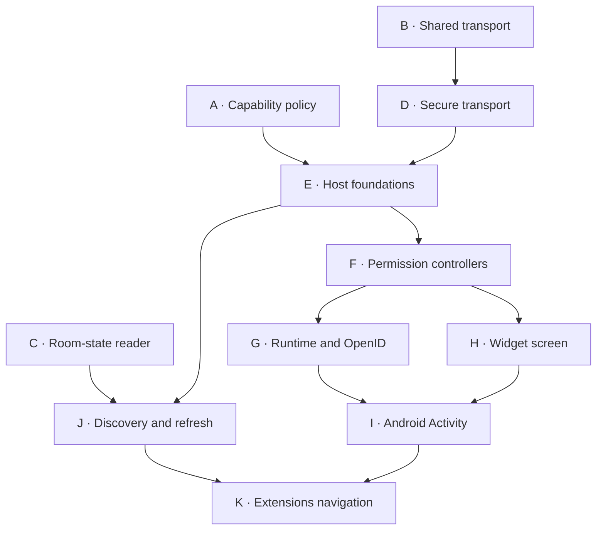

# Widget upstream preparation

This fork-only guide records the audit and branch preparation on 23 October 2026. **No new pull requests have been opened.** The existing fork review stack and its history are preserved.

The audited testing integration is [`widget-support` at `34f85ef`](https://github.com/0cwa/element-x-android/commit/34f85efbf8c6ca31bd9927b9c40b66ab4c05930c). All preparation branches use upstream [`develop` at `cd3fb0d`](https://github.com/element-hq/element-x-android/commit/cd3fb0ddca6961e0a262b9620aab07d3572598c3) as their common source base.

<!--- TOC -->

* [Audit changes](#audit-changes)
* [Test scope](#test-scope)
* [Dependency graph](#dependency-graph)
* [Incremental review units](#incremental-review-units)
* [Relationship to the existing PRs](#relationship-to-the-existing-prs)
* [Branch register](#branch-register)
* [Final source parity](#final-source-parity)
* [Validation](#validation)
* [Before opening upstream PRs](#before-opening-upstream-prs)

<!--- END -->

## Audit changes

The implementation audit is in [`6eaf51d`](https://github.com/0cwa/element-x-android/commit/6eaf51dcb0ecb92c075df1358255b8b5d3f062d1) and the small closing-path follow-up [`34f85ef`](https://github.com/0cwa/element-x-android/commit/34f85efbf8c6ca31bd9927b9c40b66ab4c05930c).

- OpenID approval and dismissal now identify the exact native prompt with a host-generated token. Reusing a widget protocol request ID cannot make a stale dialog answer a replacement request.
- Closing or replacing the bridge clears pending OpenID approval. Queued approval rechecks the active bridge and closing state before forwarding to the SDK.
- Both native error-dialog close actions cancel media permission requests immediately through the same close handler as Back.
- Widget parsing, discovery failures, and widget URL-load failures log static diagnostics rather than exception messages that can contain private room content or URLs.
- Both driver callers select their capability policy explicitly; Call retains `ElementCall`.
- Unused host plugins, build configuration, dependencies, console callback plumbing, and the unused discovered-widget type property were removed.

No new host abstraction or feature was introduced to make the slices smaller.

## Test scope

One duplicate URL-loader test was removed. Its repeated-update assertion remains in the navigation-preservation regression. One regression was added for stale OpenID approval and dismissal after bridge replacement. **The net test-method count is unchanged** across the affected test classes.

Existing tests were strengthened to assert Call's selected policy, independent deny-all expectations, immutable capability-request snapshots, private-content logging protection, and identity cancellation during graceful close.

Keep the ten media lifecycle regressions, seven capability-consent controller tests, and the focused transport, policy, discovery, and authenticated-state tests. They protect different permission, origin, cancellation, mapping, or state-identity failures. Mechanical moves receive no new behavior tests.

## Dependency graph

Each letter is a proposed review unit, not an opened PR. The arrows are actual prerequisites. A, B, and C can be discussed independently; G and H can be reviewed in parallel; discovery data J can proceed before the final Activity integration.

## Incremental review units

Each title links to the exact incremental comparison against that candidate's prerequisite tree. Production additions include build configuration and resources, exclude test code, fakes and screenshot pointers, and count mechanical renames as moves. Every unit stays below the repository's 500-production-addition limit.

| ID | Incremental diff | Requires | Production additions | Purpose |
|---|---|---|---:|---|
| A | [Explicit capability policy](https://github.com/0cwa/element-x-android/compare/cd3fb0ddca6961e0a262b9620aab07d3572598c3...262914e6b782ee1fa00a8b79c0cfae9d83452f7e) | None | 161 | Keep Call trusted; generic widgets deny or ask for exact capabilities. |
| B | [Shared transport extraction](https://github.com/0cwa/element-x-android/compare/cd3fb0ddca6961e0a262b9620aab07d3572598c3...4915bbd082c14129df7d7d009923e1a8b04cc3b5) | None | 44 | Move Call-owned message transport and rewire imports without changing behavior. |
| C | [Room-state reader](https://github.com/0cwa/element-x-android/compare/cd3fb0ddca6961e0a262b9620aab07d3572598c3...6623105ba131dca120b7309d44462b439880d0de) | None | 144 | Read authenticated room state, preserve event identity, and suppress sensitive HTTP logging. |
| D | [Secure generic transport](https://github.com/0cwa/element-x-android/compare/4915bbd082c14129df7d7d009923e1a8b04cc3b5...3c3a4e102c98ac9187f7f8a07851c5f1f6c7a5c6) | B | 258 | Pin messages to the main frame and origin; install the document-start bridge and enforce URL rules. |
| E | [Host foundations](https://github.com/0cwa/element-x-android/compare/8d12281a5e23488f1eda199d3d52ce8251dd755b...25b2df8c5551e38bbd3e31ffb21a7896e7144d8c) | A, D | 336 | Add launch data, provider, preload permission storage, URL loading, and device-ID substitution. |
| F | [Permission controllers and contracts](https://github.com/0cwa/element-x-android/compare/25b2df8c5551e38bbd3e31ffb21a7896e7144d8c...1a4418d956c2ca94015fa7b06020d6f13a4573e2) | E | 358 | Add native capability/media consent, cancellation, state contracts, and the capability dialog. |
| G | [Widget runtime and OpenID](https://github.com/0cwa/element-x-android/compare/1a4418d956c2ca94015fa7b06020d6f13a4573e2...415266535bd635d6c5f536b23537a7bdf9a7e640) | F | 480 | Run the SDK driver with stable lifetime and request-scoped OpenID approval. |
| H | [Widget screen](https://github.com/0cwa/element-x-android/compare/1a4418d956c2ca94015fa7b06020d6f13a4573e2...6a38f3bdd7600cd7f72e1e2c82bb1075d4a30a9d) | F | 439 | Render preload and permission UI and the secure WebView, with immediate media cancellation on native close. |
| I | [Android Activity integration](https://github.com/0cwa/element-x-android/compare/3864f67e8efa0fd077e71b487e86170950407994...25fb203eea072044552ec5dce84e567e1dc922c4) | G, H | 233 | Connect the runtime and screen through the Activity, entry point, DI, and manifest. |
| J | [Discovery and refresh](https://github.com/0cwa/element-x-android/compare/c8ff48d55f6e44239c6ed6ef903d80d073ddd2de...e0e6d0026ef6112a2ba8bb9666c9cb956ef796b5) | E, C | 251 | Parse room widget definitions, coalesce refreshes, and prepare launch data. |
| K | [Extensions navigation](https://github.com/0cwa/element-x-android/compare/cd6e5d15be8746bb0d8bee2c6360d91dae5d4484...d11d081faef378a51711e2fa37a9f779a0856f6a) | J, I | 384 | Connect Room Details and the Extensions screen; keep the upstream feature disabled in all builds. |

Eleven review units do not mean eleven simultaneous upstream PRs. The current seven development slices contain large mixed changes and later repairs. The preparation removes false dependencies and folds the repairs into the first affected code, while respecting [AGENTS.md](../AGENTS.md) and the small-change guidance in [CONTRIBUTING.md](../CONTRIBUTING.md#etiquette). Combining the host into one or two PRs would exceed the production-line limit.

## Relationship to the existing PRs

| Existing fork PR | Prepared treatment |
|---|---|
| [#4](https://github.com/0cwa/element-x-android/pull/4), plus the final policy/provider part of [#11](https://github.com/0cwa/element-x-android/pull/11) | A introduces the final sealed policy once, avoiding an enum-to-sealed replacement in a later submission. |
| [#5](https://github.com/0cwa/element-x-android/pull/5) | B is the mechanical extraction; D contains the new security and URL behavior. |
| [#6](https://github.com/0cwa/element-x-android/pull/6), the host/consent portions of [#11](https://github.com/0cwa/element-x-android/pull/11), and [#12](https://github.com/0cwa/element-x-android/pull/12) | E–I use cohesive existing files. Driver lifetime, media cancellation and native consent are present in the first affected implementation. There is no separate late media-fix PR. |
| [#7](https://github.com/0cwa/element-x-android/pull/7) | C is independent of the host. Its previous position after #6 was historical. |
| [#8](https://github.com/0cwa/element-x-android/pull/8) | J handles discovery and refresh; K handles navigation and the upstream-disabled flag. |
| [#1](https://github.com/0cwa/element-x-android/pull/1) | Remains the installable fork integration, including its testing default. It is not the upstream submission. |

## Branch register

These are saved preparation branches in the fork. Each candidate contributes one coherent implementation commit above its prerequisite tree. At dependency joins, preparation-only merge commits combine already prepared parents; those joins are not additional proposed PRs.

| ID | Saved branch | Candidate commit | Incremental comparison base |
|---|---|---|---|
| A | [prepare/widget-capability-policy](https://github.com/0cwa/element-x-android/tree/prepare/widget-capability-policy) | [`262914e`](https://github.com/0cwa/element-x-android/commit/262914e6b782ee1fa00a8b79c0cfae9d83452f7e) | `cd3fb0ddca6961e0a262b9620aab07d3572598c3` |
| B | [prepare/widget-transport](https://github.com/0cwa/element-x-android/tree/prepare/widget-transport) | [`4915bbd`](https://github.com/0cwa/element-x-android/commit/4915bbd082c14129df7d7d009923e1a8b04cc3b5) | `cd3fb0ddca6961e0a262b9620aab07d3572598c3` |
| C | [prepare/widget-room-state](https://github.com/0cwa/element-x-android/tree/prepare/widget-room-state) | [`6623105`](https://github.com/0cwa/element-x-android/commit/6623105ba131dca120b7309d44462b439880d0de) | `cd3fb0ddca6961e0a262b9620aab07d3572598c3` |
| D | [prepare/widget-secure-transport](https://github.com/0cwa/element-x-android/tree/prepare/widget-secure-transport) | [`3c3a4e1`](https://github.com/0cwa/element-x-android/commit/3c3a4e102c98ac9187f7f8a07851c5f1f6c7a5c6) | `4915bbd082c14129df7d7d009923e1a8b04cc3b5` |
| E | [prepare/widget-host-foundations](https://github.com/0cwa/element-x-android/tree/prepare/widget-host-foundations) | [`25b2df8`](https://github.com/0cwa/element-x-android/commit/25b2df8c5551e38bbd3e31ffb21a7896e7144d8c) | `8d12281a5e23488f1eda199d3d52ce8251dd755b` |
| F | [prepare/widget-host-permissions](https://github.com/0cwa/element-x-android/tree/prepare/widget-host-permissions) | [`1a4418d`](https://github.com/0cwa/element-x-android/commit/1a4418d956c2ca94015fa7b06020d6f13a4573e2) | `25b2df8c5551e38bbd3e31ffb21a7896e7144d8c` |
| G | [prepare/widget-host-runtime](https://github.com/0cwa/element-x-android/tree/prepare/widget-host-runtime) | [`4152665`](https://github.com/0cwa/element-x-android/commit/415266535bd635d6c5f536b23537a7bdf9a7e640) | `1a4418d956c2ca94015fa7b06020d6f13a4573e2` |
| H | [prepare/widget-host-rendering](https://github.com/0cwa/element-x-android/tree/prepare/widget-host-rendering) | [`6a38f3b`](https://github.com/0cwa/element-x-android/commit/6a38f3bdd7600cd7f72e1e2c82bb1075d4a30a9d) | `1a4418d956c2ca94015fa7b06020d6f13a4573e2` |
| I | [prepare/widget-host-activity](https://github.com/0cwa/element-x-android/tree/prepare/widget-host-activity) | [`25fb203`](https://github.com/0cwa/element-x-android/commit/25fb203eea072044552ec5dce84e567e1dc922c4) | `3864f67e8efa0fd077e71b487e86170950407994` |
| J | [prepare/widget-discovery](https://github.com/0cwa/element-x-android/tree/prepare/widget-discovery) | [`e0e6d00`](https://github.com/0cwa/element-x-android/commit/e0e6d0026ef6112a2ba8bb9666c9cb956ef796b5) | `c8ff48d55f6e44239c6ed6ef903d80d073ddd2de` |
| K | [prepare/widget-extensions](https://github.com/0cwa/element-x-android/tree/prepare/widget-extensions) | [`d11d081`](https://github.com/0cwa/element-x-android/commit/d11d081faef378a51711e2fa37a9f779a0856f6a) | `cd6e5d15be8746bb0d8bee2c6360d91dae5d4484` |

Do not open every branch directly against upstream `develop`: dependent branches still contain unmerged prerequisites. When a unit is ready, create its submission branch from the then-current upstream base and apply only that unit's implementation commit after its dependencies have landed. This also avoids carrying preparation merges and old squash ancestry into an upstream PR.

For example, once A and D have landed, the E implementation commit can be applied to a fresh branch using `git cherry-pick -x 25b2df8c5551e38bbd3e31ffb21a7896e7144d8c`. Re-run the relevant checks on the resulting revision. Leave these preparation refs and existing reviewed histories intact.

## Final source parity

The final prepared tree is [`d11d081`](https://github.com/0cwa/element-x-android/commit/d11d081faef378a51711e2fa37a9f779a0856f6a), tree `9ce511203a9ba7a1323fa9b1a740b7e32a3113c5`.

Compared with the audited integration `34f85ef`, it differs only in:

- Extensions defaults to false in every build type, with the existing default test updated accordingly.
- Redundant trailing blank lines were removed from the widget manifest and the two newly introduced Extensions/Room Details string files.

Ignoring blank lines, the feature-flag source and its existing test are the only differences. This proves that packaging did not drop a host, consent, discovery, or compatibility change. The fork integration keeps Extensions enabled for non-release testing builds.

## Validation

Completed locally:

- Pinned Ktlint 1.8.0 passes for all 88 changed Kotlin and Gradle files in the final prepared tree.
- Every incremental candidate passes `git diff --check`.
- Every saved branch head and tree hash was fetched back and checked against its prepared local tree.
- Independent policy/transport boundaries and host-stage imports, string resources, and manifest references were inspected.
- The mechanical transport files match the original files after package/import adaptation; the independent room-state candidate preserves the existing #7 increment.
- No inline review threads were present in the seven existing feature PRs when checked.

Android validation is running on the canonical integration at `34f85ef`:

- [APK builds](https://github.com/0cwa/element-x-android/actions/runs/39975644051)
- [Unit tests, screenshots and coverage](https://github.com/0cwa/element-x-android/actions/runs/39975644482)
- [Code quality checks](https://github.com/0cwa/element-x-android/actions/runs/39975643975)

At the latest preparation check, Git LFS, Ktlint, Konsist, forbidden-pattern, dependency, screenshot-file, documentation, shell and workflow-security checks passed. APK compilation, unit tests, screenshot verification and the remaining aggregate checks were not yet complete. The preparation branches do not have new PR-triggered CI; exact-revision Android checks are still required when each unit is exported for submission.

The earlier integration `42f3524` passed APK compilation, unit tests, screenshots, coverage generation and quality checks. Its Test workflow failed at the Codecov upload, and its separate Maestro run did not establish acceptance. Those historical results are not validation of the new revisions.

## Before opening upstream PRs

- Agree the initial feature scope and the temporary room-state fallback approach with maintainers, following the repository's contribution process. This audit has not contacted maintainers.
- Obtain exact-revision build/test evidence for each exported candidate. The local environment has no Android SDK; local formatting and source inspection are not a substitute for an Android build.
- Exercise Element Call and standard widgets on supported Android/WebView versions, including origin restrictions, permission denial, cancellation, close/reopen, navigation, and both themes.
- Verify real-room state replacement/deletion refresh behavior. Unit tests prove handling of sync notifications, not that every relevant state change produces such a notification in a real room.
- Review loading/error preview completeness before final UI submission; the audit did not add screenshot baselines.
- Keep the feature disabled while the series lands. Enabling it is a separate acceptance decision.
- Have the contributor write concise upstream descriptions using the original template and disclose AI assistance. This guide is review preparation, not prose to paste wholesale into a PR.

One remaining implementation tradeoff is explicit: the temporary room-state reader uses blocking OkHttp execution on the IO dispatcher. Coroutine cancellation prevents stale result delivery but does not immediately cancel the HTTP call. No existing cancellable adapter is available in this repository, so the audit did not add a speculative wrapper or dependency. Discuss this alongside the fallback's removal path when reviewing C.
